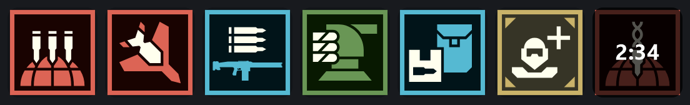

# Helldivers 2 Stratagems for Stream Dock

A plugin for **Stream Dock / fifine Control Deck** (MiraBox-based stream decks) that calls
**Helldivers 2** stratagems with one key press and shows each stratagem's **cooldown** on the key.



## About this project

I'm a Helldivers 2 player, not a programmer. I built this plugin because I wanted my
stream deck to call stratagems and track their cooldowns, and I made it with the help of
an AI coding assistant (Claude, by Anthropic), which wrote the code based on my ideas,
testing and feedback.

I use the plugin myself and tested each feature in the game, but please keep this in
mind when using it, and report any problem in [Issues](../../issues). If you're a
developer, suggestions and pull requests are very welcome.

## Features

- **115 stratagems**: orbitals, Eagles, support weapons, backpacks, vehicles, sentries,
  emplacements and mission stratagems, each with its icon.
- **One press**: opens the stratagem menu and enters the arrow code for you
  (arrows or WASD, toggle or hold menu mode).
- **Cooldown timer** on the key:
  - waits for you to **throw** the stratagem (left mouse button release);
  - counts down the **call-in time** (`↓7s`);
  - then shows the **cooldown** with a clockwise sweep until it's ready again.
- **Ship modules**: tick the upgrades you have unlocked (Zero-G Breech Loading,
  Liquid-Ventilated Cockpit, Morale Augmentation, etc.) and the times match your ship.
- Pressing the menu key before throwing **cancels** the wait.
- No extra software: uses the Node.js bundled with the deck app and Windows PowerShell.

## Install

1. Download **`HD2-Stratagems-Setup.exe`** from the [latest release](../../releases/latest).
2. Run it. It finds the deck app, closes it if needed, installs the plugin and reopens the app.
   Run it again later to **update** or **uninstall**.
3. In the deck app, find the **Helldivers 2** category and drag stratagems onto your keys.
4. Click any Helldivers key to open its settings:
   - set **Menu mode** to match your game (*Press to open* or *Hold*);
   - tick your **unlocked ship modules**.

> **"Windows protected your PC"?** The installer is not code-signed. Click
> **More info → Run anyway**. You can check the file on [VirusTotal](https://www.virustotal.com)
> or build it yourself from this repository.

Prefer a manual install? Download `HD2-Stratagems-StreamDock.zip` from the release and follow
the `INSTALL.txt` inside it.

**Requirements:** Windows 10/11 and fifine Control Deck, Stream Dock or another MiraBox-based
deck app, version 3.10 or newer.

## Settings

| Setting | What it does |
|---|---|
| Direction keys | Arrows or WASD, as bound in the game |
| Menu key / Menu mode | Key that opens the stratagem menu, and whether it is pressed (toggle) or held |
| Menu delay, Key hold, Key gap | Timing of the key presses; increase if the game misses inputs |
| Start cooldown | On throw (default) or immediately on key press |
| Cooldown animation | Smooth (4 updates/s), Medium, Light (1/s) or Off |
| Unlocked ship modules | Applies cooldown and call-in reductions |
| Throw timeout | How long a key waits for the throw before giving up |

## How it works

- `plugin/index.js` talks to the deck app over its local WebSocket plugin API
  (Elgato-style SDK) and draws the cooldown images itself.
- `plugin/hd2keys.ps1` is a small helper that sends the key presses (`SendInput` with scan
  codes) and watches for the left mouse button release that throws the stratagem.
  It only watches between the code entry and the throw, and never blocks or changes input.
- The game has an anti-cheat (GameGuard). Stratagem macros are widely used, but
  **use this at your own risk**. The plugin does not read or modify game memory.

## Building from source

Needs Node.js (any recent version) and Microsoft Edge (used headless to render the icons).

```bash
node tools/parse-wiki.js <saved Stratagems page HTML> data/stratagems.json
node tools/fetch-calltimes.js
node tools/fetch-icons.js
node tools/build.js
powershell -ExecutionPolicy Bypass -File tools/make-installer.ps1
```

- `parse-wiki.js` reads the stratagem tables from the rendered wiki page
  (`https://helldivers.wiki.gg/api.php?action=parse&page=Stratagems&prop=text&format=json`).
- `build.js` writes `manifest.json`, `plugin/stratagems.json` and the key images.
- `make-installer.ps1` builds `dist/HD2-Stratagems-Setup.exe` with the C# compiler that
  ships with Windows.

For development, copy `com.helldivers2.stratagems.sdPlugin` into
`%APPDATA%\HotSpot\StreamDock\plugins` and restart the deck app.

## Credits and disclaimer

Unofficial fan project, not affiliated with Arrowhead Game Studios or Sony Interactive
Entertainment. Stratagem icons and game data belong to their owners. Codes, cooldowns,
call-in times and icons come from the [Helldivers 2 wiki](https://helldivers.wiki.gg).
Code is under the [MIT License](LICENSE); third-party content is not.

---

### Português (resumo)

Plugin para **Stream Dock / fifine Control Deck** que chama as estratégias do
**Helldivers 2** com um botão e mostra o **cooldown** no próprio botão.
Para instalar, baixe o **`HD2-Stratagems-Setup.exe`** na [última release](../../releases/latest)
e dê dois cliques. Se o Windows avisar, clique em **"Mais informações" → "Executar assim mesmo"**.

Sou jogador, não programador: criei o projeto com a ajuda de um assistente de IA (Claude, da
Anthropic), que escreveu o código a partir das minhas ideias, testes e feedback. Problemas e
sugestões são bem-vindos em [Issues](../../issues).
